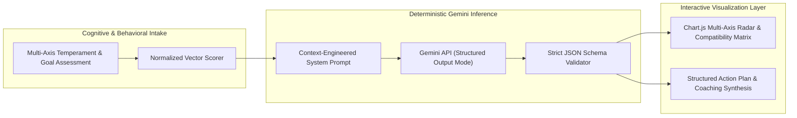

# Coach Mike AI — Structured-Output AI Psychometrics & Behavioral Telemetry Engine

> **Architecture:** Gemini API (Deterministic JSON Schema Enforcement) + Chart.js Behavioral Telemetry + Tailwind CSS + Cognitive Systems UX  

## 1. Executive Summary & Problem Statement
Unconstrained LLM outputs are conversational and non-deterministic, making raw text completions unusable for quantitative psychometric graphing, multi-axis temperament profiling, or repeatable coaching diagnostics.

**Coach Mike AI** bridges cognitive psychology and applied AI by enforcing **strict Gemini API JSON response schemas** that transform multi-variable behavioral assessments into deterministic data structures rendered directly into **Chart.js** radar/polar visualizations and actionable coaching plans.

---

## 2. System Architecture & Infrastructure Topology



---

## 3. Key Engineering Decisions & Production Highlights

### Deterministic JSON Schema Enforcement (`Gemini API`)
* Constrained model completions using strict `responseSchema` contracts so every inference call returns typed numerical weights, trait breakdowns, friction vectors, and coaching interventions with zero JSON parsing failures.

### Real-Time Psychometric Visualization (`Chart.js` + `Tailwind CSS`)
* Bound validated LLM output vectors directly to **Chart.js** canvas instances, rendering interactive temperament distributions and interpersonal compatibility overlays without page reloads.

### Cognitive Load & Human-in-the-Loop UX
* Grounded assessment phrasing and feedback loops in behavioral neuroscience and instructional design principles—preventing user fatigue while maximizing diagnostic signal density.

---

## 4. Repository Structure

```text
coach-mike/
├── src/
│   ├── components/
│   │   ├── AssessmentFlow/     # Multi-step behavioral & temperament intake UI
│   │   ├── TelemetryCharts/    # Chart.js radar, bar & compatibility visualizations
│   │   └── CoachingReport/     # Structured action plan & communication guide
│   ├── services/
│   │   ├── geminiSchema.ts     # Strict JSON schema definitions & API client
│   │   └── scoringEngine.ts    # Client-side psychometric vector normalization
│   └── App.tsx                 # State machine & session storage
└── package.json                # Project dependencies & build configuration
```

---

## 5. Local Development & Verification

```bash
# 1. Install dependencies
npm install

# 2. Configure environment variables (.env.local)
# VITE_GEMINI_API_KEY=...

# 3. Launch development server
npm run dev

# 4. Build production bundle
npm run build
```
